# DevOps Population Reporting System

[](https://github.com/GibbyAung/Devops-Population-System/actions/workflows/main.yaml?query=branch%3Amaster)
[](https://github.com/GibbyAung/Devops-Population-System/actions/workflows/main.yaml?query=branch%3Adevelop)
[](https://github.com/GibbyAung/Devops-Population-System/releases)

## Project Purpose

This Java application generates population reports from the MySQL `world` database. Maven builds and tests the application, packages a dependency-inclusive JAR, and supplies that JAR to the application Docker image. Docker Compose runs the application with MySQL, while GitHub Actions repeats the build and container checks in continuous integration.

## Current Status

The current development work implements **12 requirements of 32, which is 37.5%**:

- Requirements 1-6: country reports and Top-N country reports.
- Requirements 7-12: city reports for the world, continent, region, country, and district, plus Top-N cities in the world.

The latest `master` release currently contains Requirements 1-6. Requirements 7-12 must complete the reviewed `develop -> release -> master` flow before they can be described as released.

On 12 October 2026, the documentation-recovery branch completed 17 Maven tests with no failures and successfully ran Requirement 12 against MySQL through Docker. Screenshot evidence for Requirements 1-12 is linked below and has been reviewed by Product Owner Saw Zwel Myat Tow.

## Technology

- Java 25
- Maven
- JUnit 5
- MySQL 8.4 with the `world` database
- Docker and Docker Compose
- GitHub Actions
- Zube for Product Backlog and Sprint management

## Prerequisites

- Git
- Java 25 JDK
- Maven
- Docker with Docker Compose

Confirm the tools are installed:

```shell
git --version
java --version
mvn --version
docker --version
docker compose version
```

## Clone the Repository

```shell
git clone https://github.com/GibbyAung/Devops-Population-System.git
cd Devops-Population-System
```

## Build and Test

```shell
mvn clean test
mvn clean package
```

The dependency-inclusive executable JAR is generated under `target/` with `jar-with-dependencies` in its filename.

## Start MySQL and Build the Application Image

Run Maven before building the Docker image because the Dockerfile copies the dependency-inclusive JAR from `target/`:

```shell
mvn clean package
docker compose up -d mysql
docker compose build app
docker compose ps
```

After changing Java code, repeat both `mvn clean package` and `docker compose build app`. Otherwise Docker may run an older JAR.

## Run Country Reports

Requirement 1 uses no application argument. With Compose MySQL running, execute the JAR locally:

```shell
DB_HOST=localhost java -jar target/*-jar-with-dependencies.jar
```

Run Requirements 2-6 in Docker:

```shell
# Requirement 2: countries in a continent
docker compose run --rm app Asia

# Requirement 3: countries in a region
docker compose run --rm app region "Eastern Asia"

# Requirement 4: Top-N countries in the world
docker compose run --rm app top-n 10

# Requirement 5: Top-N countries in a continent
docker compose run --rm app continent-top-n Asia 10

# Requirement 6: Top-N countries in a region
docker compose run --rm app region-top-n "Eastern Asia" 10
```

## Run City Reports

```shell
# Requirement 7: all cities in the world
docker compose run --rm app city-world

# Requirement 8: cities in a continent
docker compose run --rm app city-continent Asia

# Requirement 9: cities in a region
docker compose run --rm app city-region "Eastern Asia"

# Requirement 10: cities in a country (ISO country code)
docker compose run --rm app city-country CHN

# Requirement 11: cities in a district
docker compose run --rm app city-district California

# Requirement 12: Top-N cities in the world
docker compose run --rm app city-top-world 10
```

Stop the containers when finished:

```shell
docker compose down
```

Do not use `docker compose down -v` unless intentionally deleting and rebuilding the local MySQL volume.

## Required Report Columns

Country reports contain:

```text
Code | Name | Continent | Region | Population | Capital
```

City reports contain:

```text
Name | Country | District | Population
```

All report rows are ordered from largest population to smallest. Top-N commands require a positive whole number.

## GitFlow Workflow

The project uses:

```text
short-lived branch -> develop -> release -> master
```

- Do not commit directly to `master` or `develop`.
- Develop features and documentation on short-lived branches.
- Open pull requests into `develop`, request peer review, and require green GitHub Actions.
- Move accepted releases from `develop` through `release` to `master`.
- See [`CODE_OF_CONDUCT.md`](CODE_OF_CONDUCT.md) for team rules and the Definition of Done.

## Continuous Integration

The GitHub Actions workflow at `.github/workflows/main.yaml`:

1. Checks out the repository.
2. Configures Java 25.
3. Runs `mvn clean package`, including tests.
4. Builds the Docker image.
5. Starts the application with MySQL through Docker Compose.
6. Displays application logs and cleans up containers.

## Use Cases

- Country reports: [`use-cases/country-report/`](use-cases/country-report/)
- City reports: [`use-cases/city-report/`](use-cases/city-report/)
- Use-case diagram: [`use-case.puml`](use-case.puml)

## Releases

Published versions are available on the [GitHub Releases page](https://github.com/GibbyAung/Devops-Population-System/releases).

The release badge identifies the latest published version; it does not imply that unmerged development work has already been released.

## Requirement Evidence

The following table reports implementation on the current development work. Requirements with long output use a second image to show the final row count and total population. The same code and evidence must complete the release flow to `master` before final delivery.

| ID | Name | Met | Screenshot |
|---:|---|:---:|---|
| 1 | All countries in the world by population | Yes | 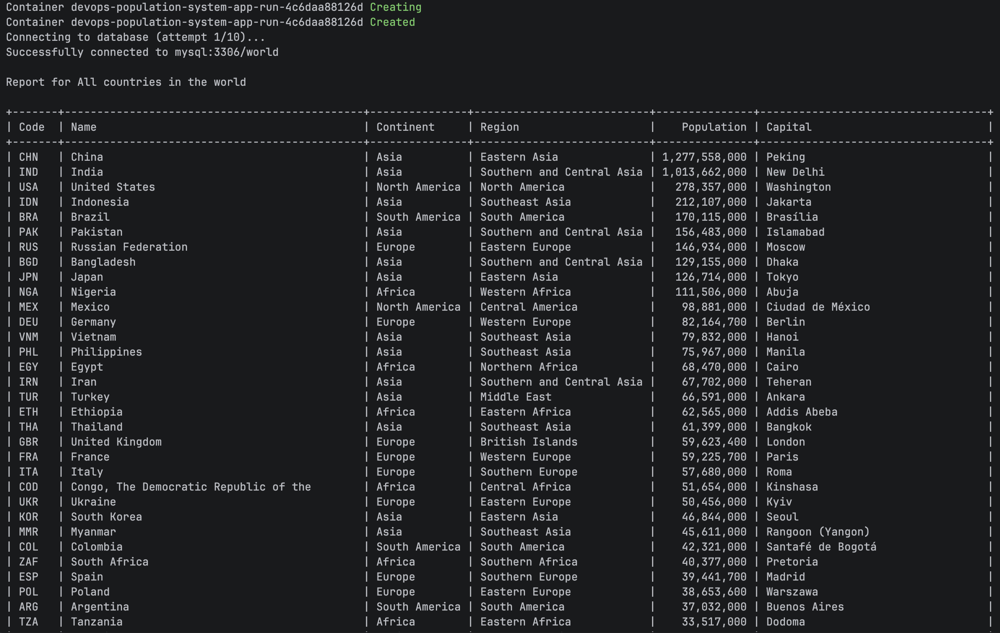 |
| 2 | All countries in a continent by population | Yes | 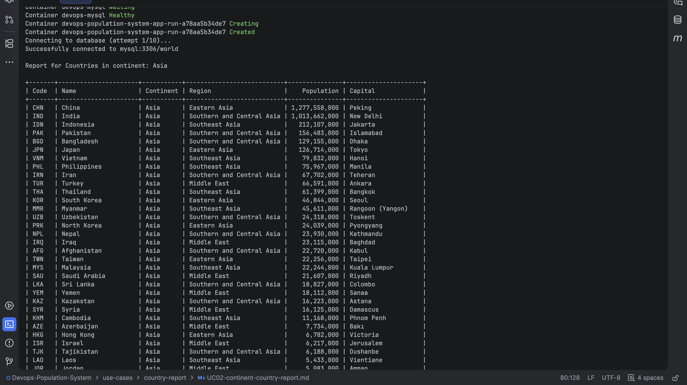 |
| 3 | All countries in a region by population | Yes | 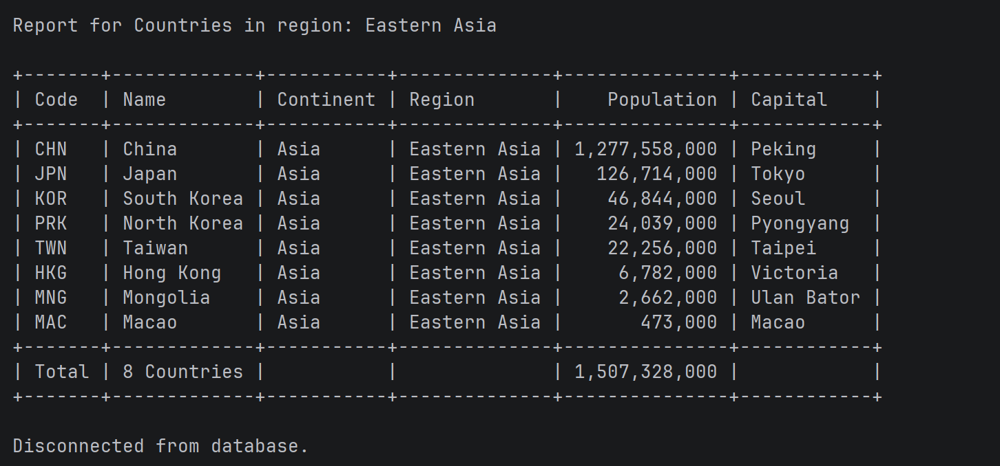 |
| 4 | Top-N countries in the world | Yes | 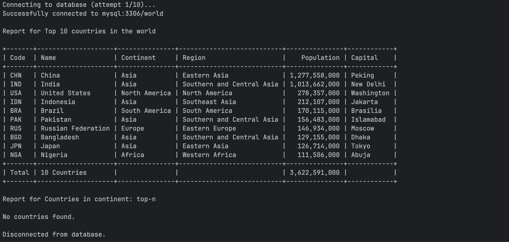 |
| 5 | Top-N countries in a continent | Yes | 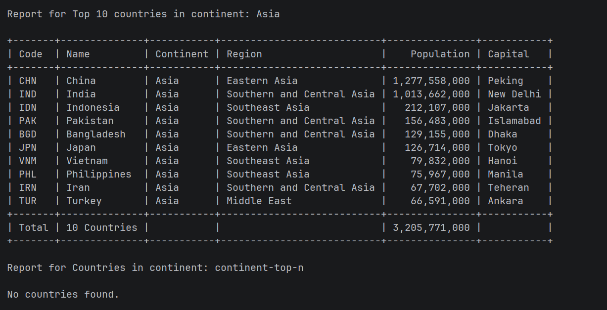 |
| 6 | Top-N countries in a region | Yes | 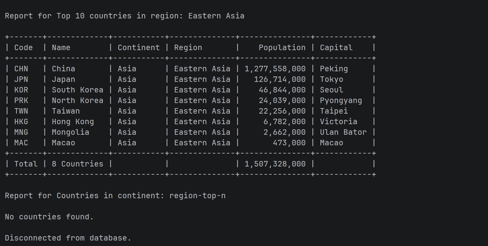 |
| 7 | All cities in the world by population | Yes | 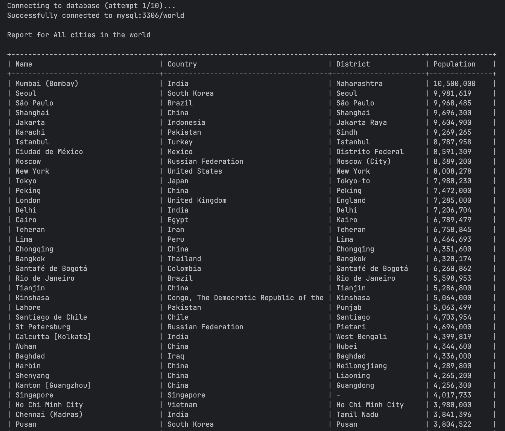<br>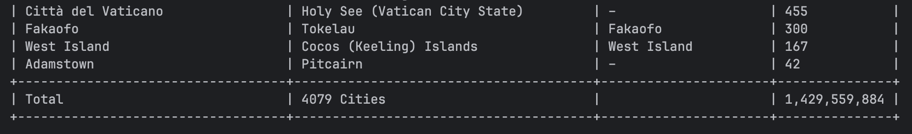 |
| 8 | All cities in a continent by population | Yes | 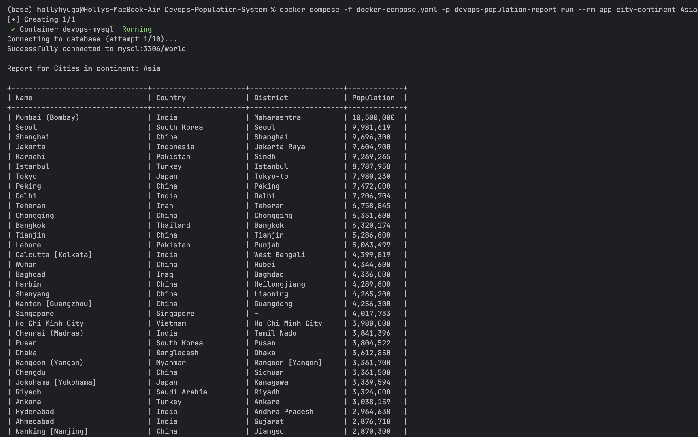<br>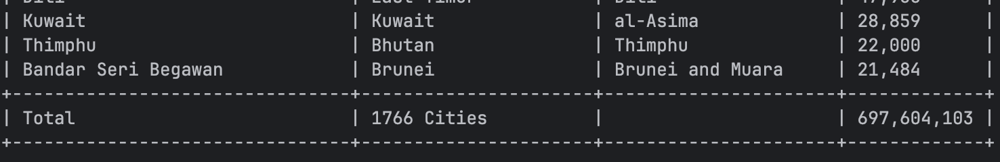 |
| 9 | All cities in a region by population | Yes | 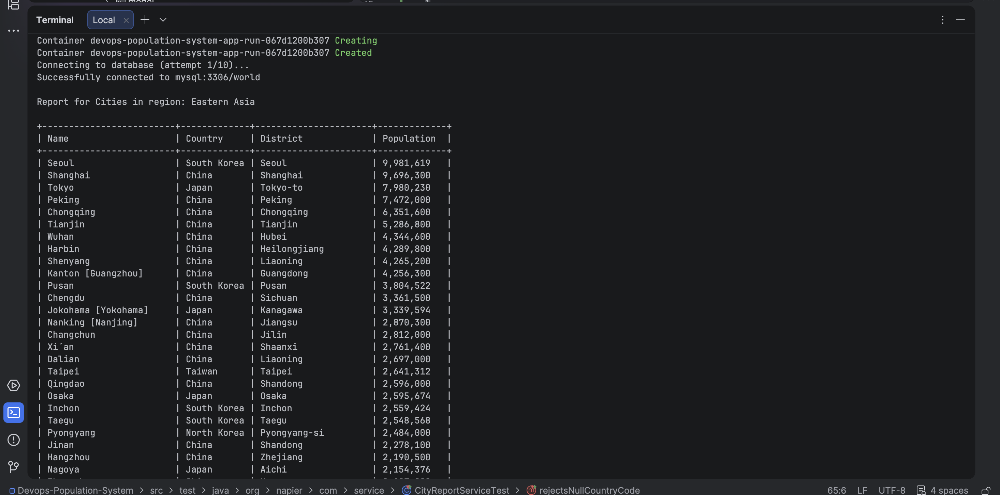<br>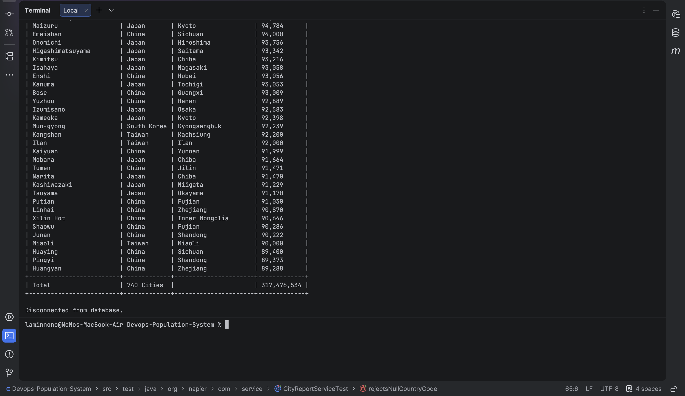 |
| 10 | All cities in a country by population | Yes | 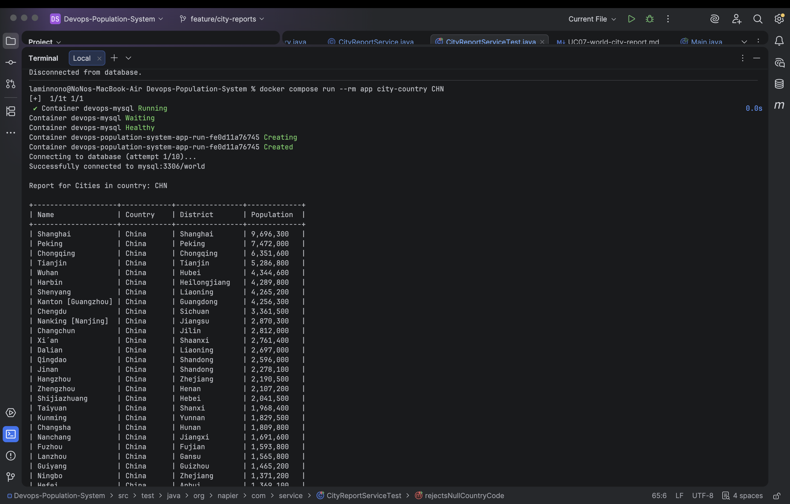<br>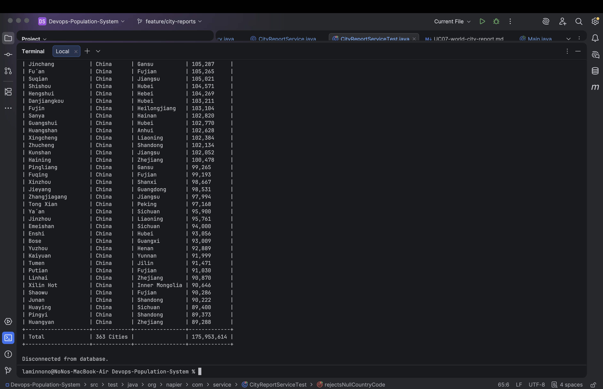 |
| 11 | All cities in a district by population | Yes | 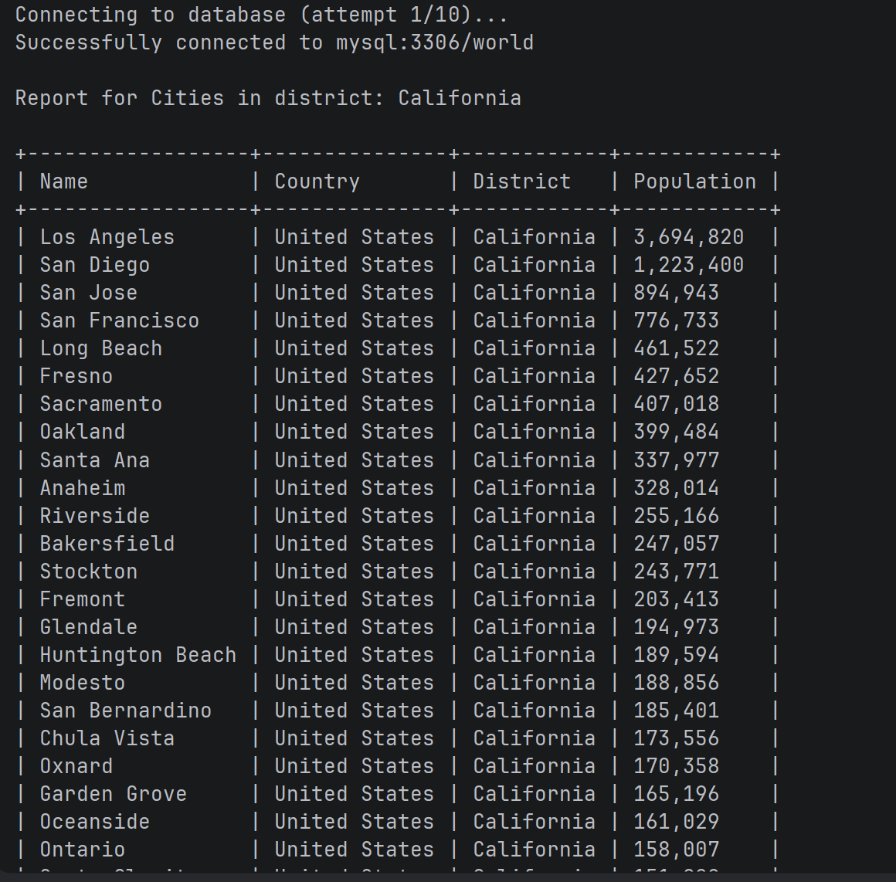<br>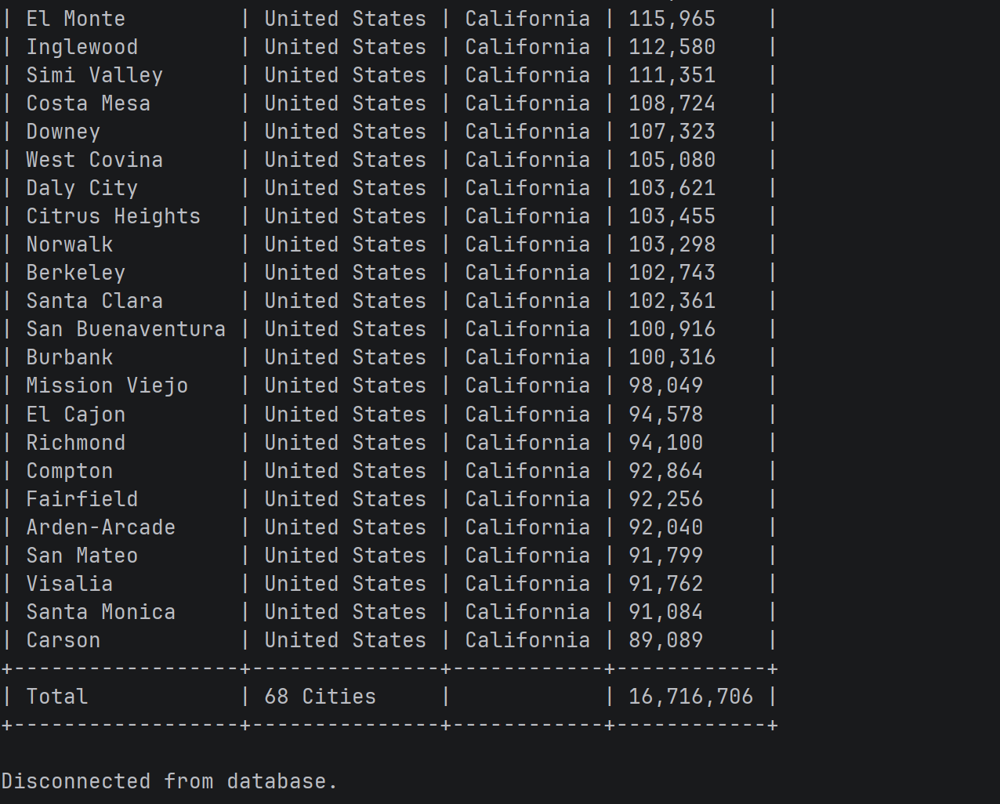 |
| 12 | Top-N cities in the world | Yes | 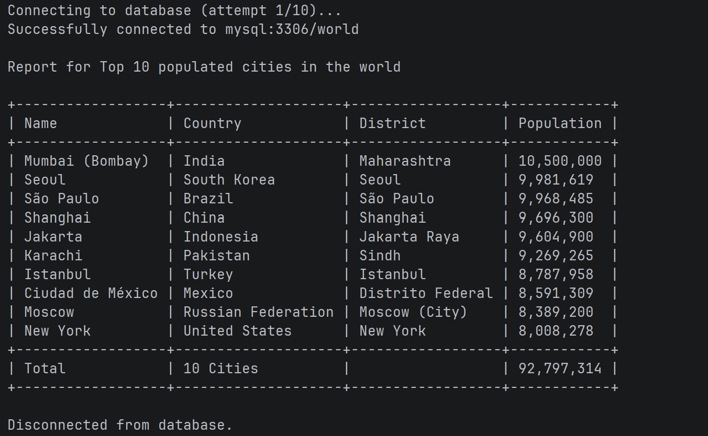 |
| 13 | Top-N cities in a continent | No | |
| 14 | Top-N cities in a region | No | |
| 15 | Top-N cities in a country | No | |
| 16 | Top-N cities in a district | No | |
| 17 | All capital cities in the world | No | |
| 18 | All capital cities in a continent | No | |
| 19 | All capital cities in a region | No | |
| 20 | Top-N capital cities in the world | No | |
| 21 | Top-N capital cities in a continent | No | |
| 22 | Top-N capital cities in a region | No | |
| 23 | Population, city population, and non-city population by continent | No | |
| 24 | Population, city population, and non-city population by region | No | |
| 25 | Population, city population, and non-city population by country | No | |
| 26 | Population of the world | No | |
| 27 | Population of a continent | No | |
| 28 | Population of a region | No | |
| 29 | Population of a country | No | |
| 30 | Population of a district | No | |
| 31 | Population of a city | No | |
| 32 | Five language populations and world percentages | No | |

Detailed evidence rules and the verification register are in [`evidence/README.md`](evidence/README.md).

## Team and Scrum Roles

| Name | Scrum role |
|---|---|
| Saw Zwel Myat Tow | Product Owner |
| Win Myat Aung | Scrum Master |
| Ye Win Htet | Developer / Team Member |
| La Min No No | Developer / Team Member |
| Wai Yan Aung | Developer / Team Member |
| Htet Htet Oo Wai | Developer / Team Member |
| May Thukha Chit | Developer / Team Member |

Private contribution percentages, matriculation numbers, and personal contact details are intentionally not published.

## Outstanding Assessment Items

- **Coverage:** configure real coverage reporting for `master` before adding the required coverage badge.
- **Licence:** the team has selected Apache License 2.0, but the complete root `LICENSE` file must be added and detected by GitHub before adding the required licence badge.
- **Release:** merge accepted development work through `release` to `master` and publish the next release.
